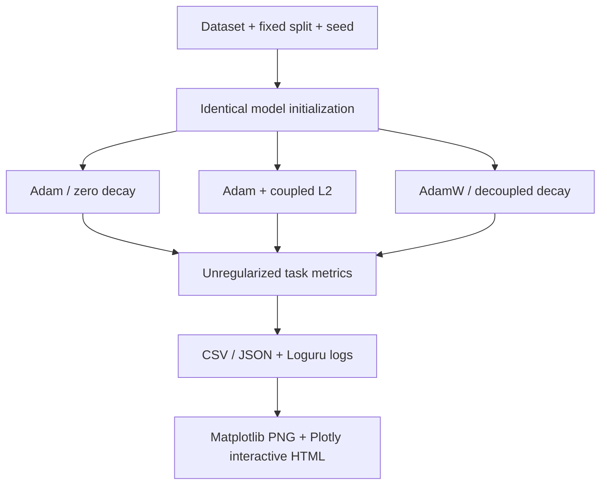

# Adam + L2 versus AdamW: Reproducible Optimizer Experiments

A controlled, instrumented PyTorch benchmark of **coupled L2 regularization**
(`torch.optim.Adam(weight_decay=λ)`) versus **decoupled weight decay**
(`torch.optim.AdamW(weight_decay=λ)`). Includes a no-decay Adam baseline.

[](https://github.com/1998x-stack/adam-vs-adamw/actions/workflows/ci.yml)

> **Science first:** same numerical λ does **not** imply equivalent regularization.
> Plots and metrics are generated from real model runs; no synthetic benchmark
> results or fabricated performance claims are checked into this repository.

## Experiments

| ID | Dataset | Model | Why this experiment? | Output |
|---|---|---|---|---|
| A | Anisotropic 2D quadratic | two trainable coordinates | inspect update trajectory and L2/preconditioner coupling | contour + optimizer paths |
| B | [scikit-learn Two Moons](https://scikit-learn.org/stable/modules/generated/sklearn.datasets.make_moons.html) | 2→64→64→1 Tanh MLP | visualize learning a nonlinear decision boundary | boundary PNG/HTML; BCE/accuracy/norm curves |
| C | [CIFAR-10](https://www.cs.toronto.edu/~kriz/cifar.html) | ResNet-18 with CIFAR stem | compare generalization on real images | validation/test accuracy and CE curves |
| D | [WikiText-2 raw](https://huggingface.co/datasets/Salesforce/wikitext) | 2-layer causal Transformer | study decoupling in language modeling | token CE and perplexity |

### Visual experiment flow



## Installation

Python 3.10+ required. A GPU is recommended for the CIFAR and WikiText runs.

```bash
git clone https://github.com/1998x-stack/adam-vs-adamw.git
cd adam-vs-adamw
python -m venv .venv
source .venv/bin/activate
python -m pip install -e ".[dev]"
# Optional heavyweight datasets/models:
python -m pip install -e ".[vision,nlp]"
```

## Quick runs: mechanistic and classification figures

```bash
# A: Loss contours and parameter trajectories (CPU-friendly)
python -m adamw_lab.run --experiment quadratic --seeds 42 --steps 100 \
  --lr 0.05 --weight-decay 0.5

# B: Nonlinear classification and paired metrics (CPU-friendly)
python -m adamw_lab.run --experiment moons --seeds 42,43,44,45,46 \
  --steps 1200 --lr 0.003 --weight-decay 0.01

# B2: Validation-only LR vs regularization hyperparameter sweep.
# Do NOT interpret numerically identical λ as equivalent strength.
python -m adamw_lab.run --experiment moons --sweep \
  --methods adam_l2,adamw --steps 600 --seeds 42,43,44

# Quick smoke test
python -m adamw_lab.run --experiment moons \
  --seeds 42 --steps 10 --eval-every 5 --run-name smoke
```

## Real-world vision and language datasets

```bash
# C: Downloads public CIFAR-10, holds out 10k validation from official 50k.
# ResNet-18 (random init); final evaluation on untouched official test set.
python -m adamw_lab.run --experiment cifar10 --epochs 20 \
  --batch-size 128 --seeds 42,43,44 --device cuda --lr 0.001

# D: Downloads Salesforce/wikitext WikiText-2 raw and GPT-2 tokenizer
# (NOT pretrained GPT-2 weights); trains a tiny causal Transformer from scratch.
python -m adamw_lab.run --experiment wikitext2 --steps 500 \
  --batch-size 16 --seq-len 128 --seeds 42,43,44 \
  --device cuda --lr 0.0003
```

**Dataset selection rationale:** 2D synthetic data permits mechanistic inspection,
CIFAR-10 tests real visual classification without extreme hardware requirements,
and WikiText-2 represents next-token language modeling relevant to LLM training.
No dataset files or model weights are stored in the repository.

## Results and visualization

Every run produces an isolated `outputs/<experiment>/<run-name-or-UTC-time>/` directory:

```text
config.json            # CLI and run configuration
run.log                # Loguru timestamped experiment messages
metrics.csv            # per-step/per-epoch raw task metrics
summary.csv / .json    # per-method, per-seed final validation/test metrics
training_curves.png    # mean +/- SD across paired seeds
training_curves.html   # standalone offline Plotly with metric selector
quadratic_trajectories.png / .html  # track A
boundary_<method>.png / .html       # track B
sweep.csv / sweep_heatmap.png / sweep_<method>.html  # track B sweep
```

You can view generated PNGs locally and open HTML interactively in a browser.
GitHub displays PNG files if committed; the HTML files are **downloadable build
artifacts**, not rendered interactively in the GitHub source preview. The
[GitHub Actions workflow](../../actions/workflows/ci.yml) runs A/B smoke tests
and uploads the *actual* smoke-generated PNG/HTML/CSV bundle.

## Exact mathematical comparison

```text
Adam + L2 (coupled):
    g_t <- ∇L_task(θ_t) + λθ_t
    m_t, v_t <- moments of g_t
    θ <- θ - η m_hat / (sqrt(v_hat) + ε)

AdamW (decoupled):
    g_t <- ∇L_task(θ_t)
    m_t, v_t <- moments of g_t
    θ <- (1 - ηλ)θ - η m_hat / (sqrt(v_hat) + ε)
```

The param-group mask excludes biases and vector norm parameters from *both*
regularizers by default. The 2D quadratic opts into decaying its vector.
Use identical seeds, schedules, and data orders for matched-run comparison;
**independently tune LR and λ** for final generalization claims.

## Interpretation and limitations

Read [experiment protocol](docs/experiment_protocol.md) before drawing conclusions.
In particular, hyperparameter sweeps use **validation only**, while test results
are collected at the end. Matched raw task loss is used throughout; the
coupled L2 penalty is NOT added to reported BCE/CE. PyTorch updates inside the
optimizers, not a post-hoc extra L2 loss.

For scientifically robust conclusions, increase seed count and training budget,
sweep LR/λ for both methods, and report uncertainty rather than selecting
individual favorable runs.

## Testing

```bash
python -m pytest -q
```

References: [Adam](https://arxiv.org/abs/1412.6980),
[Decoupled Weight Decay Regularization](https://arxiv.org/abs/1711.05101),
[PyTorch Adam](https://docs.pytorch.org/docs/stable/generated/torch.optim.Adam.html),
[PyTorch AdamW](https://docs.pytorch.org/docs/stable/generated/torch.optim.AdamW.html).
